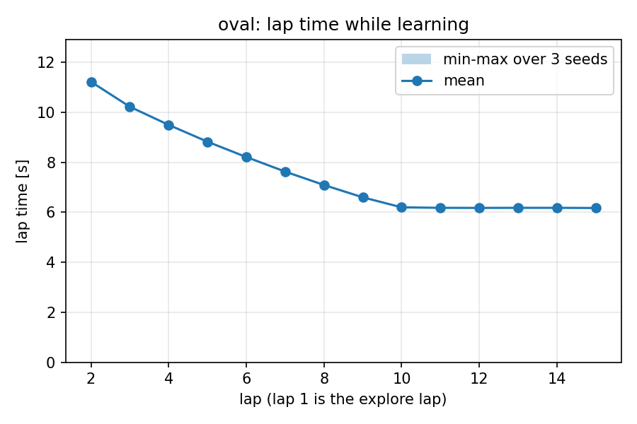

# racecar

A 1/10 scale RC car that learns to race by itself.

Put it on a track it has never seen. It drives one slow lap to map the track, then goes faster every lap after that. If I move the walls around it notices and starts over from the slow lap.

Only sensor is a 2D lidar. All the compute is on the car (Jetson Orin Nano).

Plan:

- write a small 2D simulator first and get everything working there
- then run the same code on the real car

Status: the simulator part is done (below). Ordering parts for the car, see [shopping-list.md](shopping-list.md).


## How it drives

Every frame the mode manager reads the lidar, the pose and the speed through one small interface
(`CarInterface`: `get_scan`, `get_pose`, `get_speed`, `set_drive`) and decides what to do:

1. **EXPLORE**: 0.8 m/s, stay centred between the walls, count every lidar hit into an occupancy grid.
2. **PLAN** (once, when the car is back at its start): slide the explore path onto the ridge of the distance
   transform to get the centerline, smooth it into a racing line that keeps 0.3 m from the walls, and compute a
   speed profile from curvature (`v = sqrt(a_lat_max / |kappa|)`) with braking and acceleration limits.
3. **RACE**: pure pursuit on the racing line. The line is cut into 20 sections and each section has a speed
   multiplier that starts at 0.6. After every lap a section that went cleanly gets 8 % faster, a section with a
   problem (big tracking error, safety reflex fired, crash) gets 15 % slower. Multipliers are saved per track.
4. **Safety reflex**, in every mode, after the controller: predict the shape the car body sweeps along the
   commanded steering arc; if a lidar hit lands in it within 0.6 s, slow down to the speed that keeps it 0.6 s
   away, and if the path is blocked head for the widest gap instead. This is the part that becomes a C++ node on
   the real car.
5. **TRACK_CHANGED**: while racing, if more than 35 % of the beams land where the map has no wall for 2 s, throw
   away the map, the plan and the multipliers and explore again from wherever the car is.

A box that is on the track during the explore lap is just more wall: it ends up in the map and the plan goes
around it. A box dropped after planning is caught by the reflex, mapped while racing, and the plan is rebuilt
around it a few frames later.

Nothing in `racer/mapping`, `planning`, `control`, `learning`, `safety` or `modes` imports pygame, so the same
code will run on the car with a `RosCar` behind the interface.

## Results (simulation)

15 laps, three lidar-noise seeds per track. Lap 1 is the explore lap. No run crashed.

| track   | explore lap | first race lap | lap 15 |
|---------|------------:|---------------:|-------:|
| oval    | 26 s | 11.2 s | 6.2 s |
| hairpin | 29 s | 12.2 s | 6.7 s |
| chicane | 28 s | 12.7 s | 6.9 s |



Swapping the oval for the chicane under the car at lap 8: the mismatch is noticed in 2 s, the car re-explores and
learns the new track.


More numbers, the multiplier plots and the obstacle runs: [docs/results_sim.md](docs/results_sim.md).

## Running it

```
python -m racer.sim.main --track oval                 # window with the dashboard; R reset, SPACE pause, N next track, A manual
python -m racer.sim.main --track hairpin --headless --laps 15      # no window, as fast as the CPU goes
python -m racer.sim.main --track oval --swap-track chicane --swap-at-lap 4 --laps 10
python -m racer.sim.main --track oval --obstacles --laps 6         # boxes from config.yaml are there from the start
python -m racer.sim.main --track oval --drop-box 6.33 0.65 0.3 0.3 --drop-at-lap 3 --laps 8
python -m pytest tests                                # 31 unit tests
python tools/plot_plan.py oval                        # map, centerline, racing line, speed profile of the last run
python tools/run_experiments.py && python tools/plot_learning.py   # the plots above, a few minutes
python tools/make_tracks.py                           # regenerate tracks/oval, hairpin, chicane
```

Every number lives in [racer/config.yaml](racer/config.yaml). Runs write `logs/laps.csv`, `logs/events.csv` and
the map, centerline, racing line, speed profile and multipliers as `logs/<track>_*.npy`.

## Layout

```
racer/
  interface.py   CarInterface and the lidar beam angles
  sim/           track from PNG, bicycle model, lidar, SimCar, main loop, overlays, gif
  mapping/       occupancy grid, centerline, change detector
  planning/      racing line, speed profile
  control/       pure pursuit
  learning/      per-section multipliers
  safety/        the reflex
  modes/         explore controller, mode manager
  dashboard/     the side panel
tests/           one file per module
tools/           track generator, experiments, plots
```
