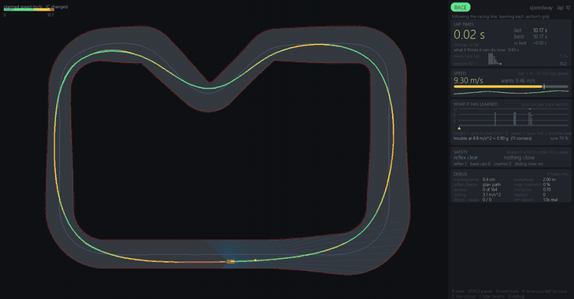
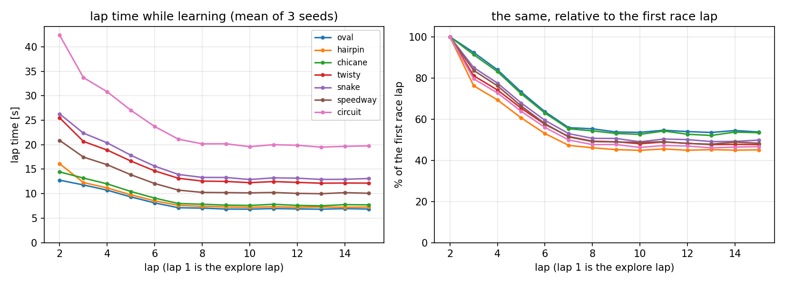
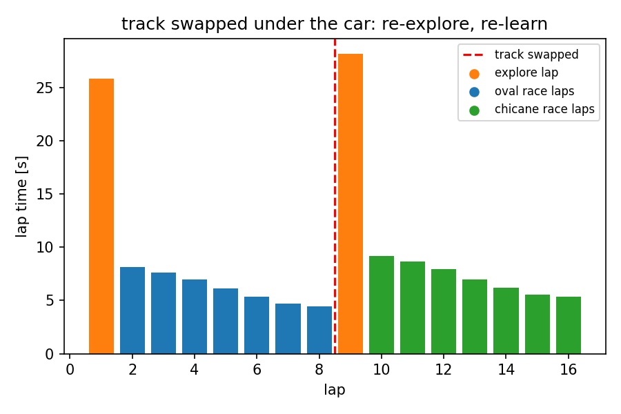
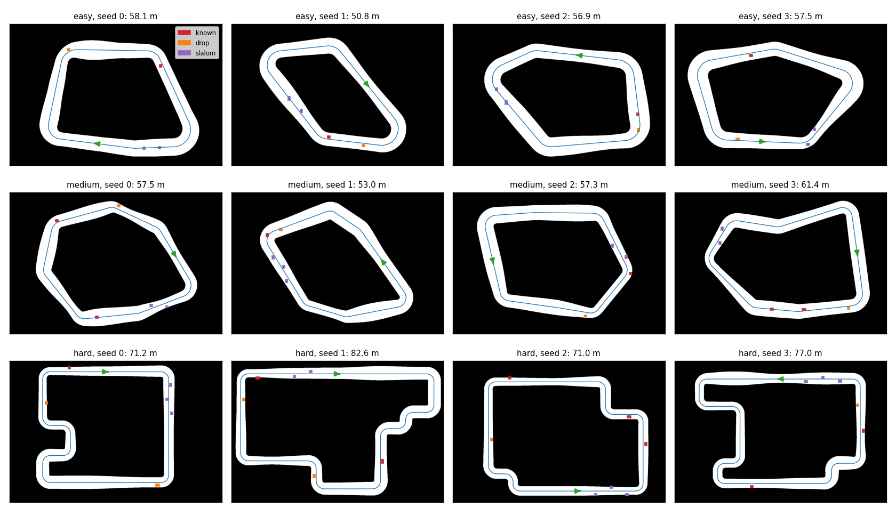
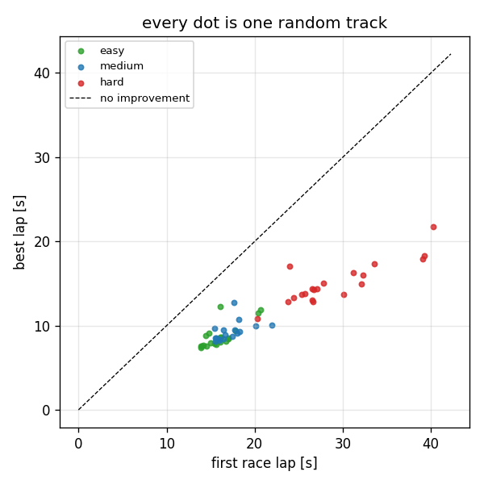
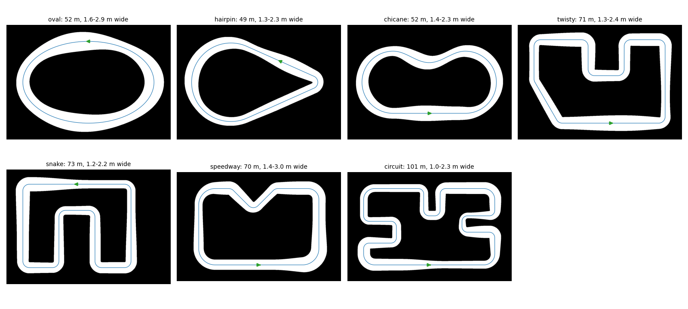
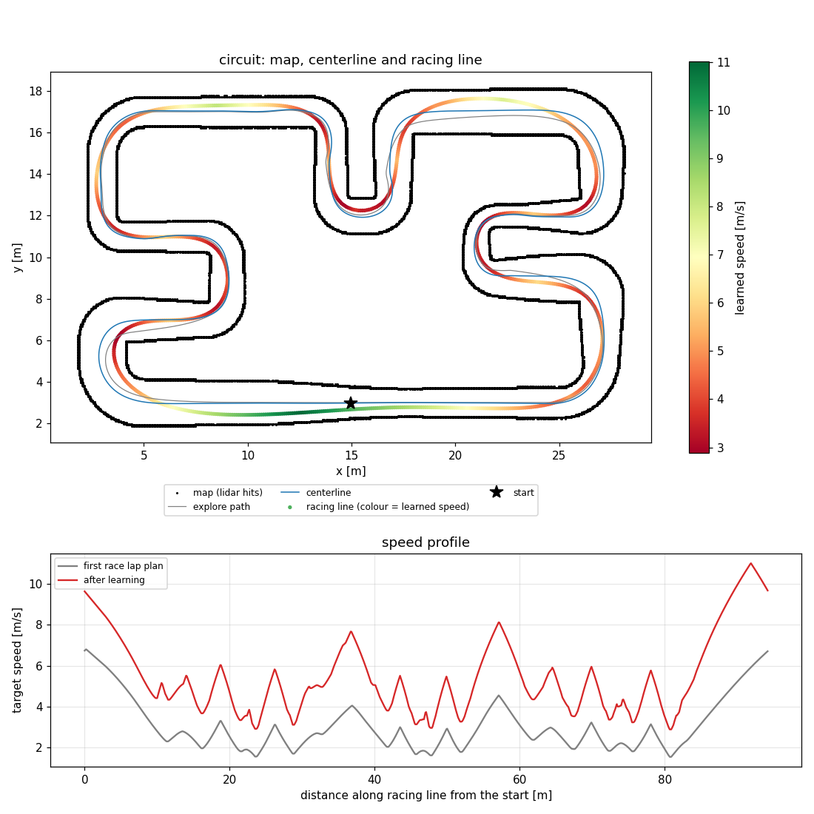

# racecar

A 1/10 scale RC car that learns to race by itself.

Put it on a track it has never seen. It drives one slow lap to map the track, then goes faster every lap after that.
If I move the walls around, it notices and starts over from the slow lap.

The only sensor is a 2D lidar, and all the compute is on the car (Jetson Orin Nano).

The plan is to write a small 2D simulator first, get everything working there, and then run the same code on the
real car. The simulator part is done (below). I'm ordering the parts for the car now; see
[shopping-list.md](shopping-list.md).



## How it drives

Every frame the mode manager reads the lidar, the pose and the speed through one small interface
(`CarInterface`: `get_scan`, `get_pose`, `get_speed`, `set_drive`) and decides what to do.

1. EXPLORE: drive at 0.8 m/s and count every lidar hit into an occupancy grid. On a narrow track the car stays
   centred between the walls. Where the track is wide, it follows the gap: every near edge in the scan is widened by
   half the car, and it aims at the deepest direction left. A box in its path with room on both sides gets the
   smallest sidestep that clears it, and the car never picks a turn that would swing its side into something. A lap
   ends when the car crosses a finish line drawn through its start, so a wide line round the start still counts.
2. PLAN, once the lap is done: slide the explore path toward the middle of the track (the ridge of the distance
   transform) to get the centerline. Every point moves only inside its own free stretch and neighbours are pulled
   together, so near a box the centerline ramps smoothly round it. Then solve for the racing line that bends least
   while keeping 0.35 m from every wall and box (one bounded least-squares problem), and build a speed profile from
   grip with `v = sqrt(grip * R)`. Braking and accelerating only get the grip a corner leaves over (friction
   ellipse).
3. RACE: pure pursuit on the racing line. In bends the lookahead shrinks so the car cuts a corner by at most 10 cm,
   and it asks for the planned speed a moment early because the speed controller lags.
4. Learning, after every race lap. The line is cut into sections about 0.4 m long (at least 60). Each has a speed
   multiplier (the grip that section trusts, rebuilt into the speed profile) and a confidence, which is its clean
   laps in a row. Multipliers start at 0.6. A clean lap raises a section by 5 % times its confidence, up to 15 %. If the car slid there, left
   the line by more than 0.12 m or needed the reflex, the section drops 10 % (25 % after a crash), its confidence
   resets, and that speed becomes a ceiling it stays just under, trying 6 % past it after two clean laps. The car
   spots a slide when it turns less than its steering asked for; on the real car the IMU can measure the same thing.
5. Safety reflex, in every mode, after the controller. While the car follows its plan, the reflex runs pure pursuit
   forward on the bicycle model to see where the car will really go. If a lidar hit lies on that path less than
   0.6 s away, it slows down to keep it 0.6 s away. Off the plan it predicts the shape the body sweeps along the
   current steering arc instead, and if that path is blocked it heads for the widest gap. This is the part that
   becomes a C++ node on the real car.
6. TRACK_CHANGED: while racing, if more than 35 % of the beams land where the map has no wall for 2 s, the car throws
   away the map, the plan and the multipliers and explores again from wherever it is.
7. Reverse recovery, in every mode: if the car wants to drive but has not moved for 1 s (usually because the reflex
   parked it nose-in against something), it backs up 0.5 m with the wheels turned away from the way out and tries
   again. The lidar cannot see straight behind, so each back-up is checked against the map built so far. After
   three tries at the same spot it stops and reports STUCK.

A box that is on the track during the explore lap is just more wall: it ends up in the map and the plan goes around
it. A box dropped after planning is caught by the reflex and mapped while racing, and within a second the racing line
is rebuilt to go round one side of it. The centerline stays as it was.

Nothing in `racer/mapping`, `planning`, `control`, `learning`, `safety` or `modes` imports pygame, so the same code will
run on the car with a `RosCar` behind the interface.

## Results (simulation)

The tracks are as big as a 12 m lidar sensibly allows: 25 x 17.5 m and 30 x 20 m, laps of 49 to 101 m, and widths
that change along the lap between about 1 and 3 m. The sim car has a grip limit of about 0.8 g and a top speed of
12 m/s (stopping from 12 m/s takes 12 m, the lidar's range), so the speed it learns is the speed its tyres allow.

15 laps on each of the seven tracks, three lidar-noise seeds each, lap 1 is the explore lap. No run crashed.

| track    | explore lap | first race lap | best lap |
|----------|------------:|---------------:|---------:|
| oval     |  60 s | 12.8 s |  6.8 s |
| hairpin  |  60 s | 16.1 s |  7.2 s |
| chicane  |  65 s | 14.4 s |  7.5 s |
| twisty   |  85 s | 25.5 s | 12.1 s |
| snake    |  88 s | 26.3 s | 12.9 s |
| speedway |  82 s | 20.9 s | 10.0 s |
| circuit  | 122 s | 42.4 s | 19.5 s |



By lap 15 every track is down to about half its first race lap, and each gets within 5 % of its best after about
seven race laps. On the straights the car reaches 10 to 10.6 m/s, the fastest it can go and still brake for the next
corner. The same tracks also finish without a crash with a box on each, with a box dropped in front of the car
mid-race, and over 30 laps.

When the oval is swapped for the chicane under the car at lap 8, it notices the mismatch within 2 s, explores again
and learns the new track.



More numbers, a learning curve and the learned multipliers for every track, and the obstacle runs are in
[docs/results_sim.md](docs/results_sim.md).

## Reading the dashboard

The window shows the track on the left and a panel on the right. The panel reads the car's state and never changes
how it drives.

- Track: the racing line is coloured by planned speed, blue for slow and red for fast. Press C to colour it by the
  grip each section trusts, or by its confidence. The thin blue line is the centerline, the white line is where the
  car actually drove over the last lap, the cyan line ahead of the car is the path the reflex is checking, and the
  yellow dot is where pure pursuit is aiming. Red dots are mapped walls, bright while exploring. The car turns orange
  while its tyres slide and gets a red ring while the reflex brakes.
- Lap times: this lap, the last one, the best one, and "what it thinks it can do now", which is the lap time its
  current plan and learned grip add up to. The bars show every race lap; the best is green and the last is white.
- Speed: actual speed against what the controller asks for, on a bar from 0 to top speed, with a short history.
- What it has learned: one bar per section of the line. Height is the grip that section trusts in m/s², colour is how
  sure it is (clean laps in a row), and a white tick marks where it last had trouble. Small boxes are straights,
  where speed never tests the grip. "Trouble at ... g" is the median grip at which corners last slid, left the line
  or made the reflex brake.
- Safety: whether the reflex is braking, how long until something on the checked path would be hit, and counts of
  reflex events, back-ups and crashes.
- Debug, toggled with D: tracking error, lookahead distance, whether the reflex is checking the planned path or the
  steering arc, map mismatch (what the track-change detector sees), the current section's multiplier and ceiling,
  replans, dropped boxes, track swaps, and how much faster than real time the sim is running.

## Random tracks

`--random` builds a new track from a seed and drives it. Easy tracks have a few big sweeping corners, and medium ones
are tighter and narrower. Hard ones follow the outline of a random blob of grid cells, which gives L, U and S shapes
with 1.0 to 1.2 m corners. The width wanders along the lap: 1.0 to 2.0 m on hard tracks, up to 3.0 m on easy ones.
There are four sizes, from 8 x 6 m up to `xl` at 30 x 20 m (laps of 50 to 90 m). Boxes come three ways: placed
before the explore lap, dropped mid-race (only once the car could still stop for them), or set out as a slalom.

Every candidate track is checked before it is used: corner radius, gaps between passes, room next to every box, what
a dropped box does to the change detector, and a run of the real planner on the true walls. Between a third and nine
tenths of candidates pass, and the generator just tries the next one.



10 laps on each track, all three kinds of boxes:

| size   | tracks | finished | crashes |
|--------|-------:|---------:|--------:|
| medium |     90 |       89 |       0 |
| large  |     90 |       90 |       0 |
| xl     |     60 |       57 |       0 |

On every track it finished, the best lap is faster than the first race lap, by 45 to 48 % on average. The four that
did not finish all stopped on the slow first lap, where the car reached the corner of a slalom box at a slight angle
and could not back out of it in three tries.



## Tracks

Seven hand-made tracks live in `tools/make_tracks.py`. The first five are the original small tracks drawn 2.5 times
bigger (25 x 17.5 m); the last two are new (30 x 20 m). The width changes along every lap.



- `oval` (52 m, 1.6 to 2.9 m wide): no straights and no tight corners, so the car can keep its speed up all the way
  round. The track swap test starts here.
- `hairpin` (49 m): a teardrop. Two long straights meet in one tight U-turn at the narrow end, so this one is about
  braking hard and late.
- `chicane` (52 m): an oval with an S-bend pushed into the top straight. The car has to change direction quickly at
  speed.
- `twisty` (71 m, nine corners): a deep pocket cut into the top and a long diagonal on the left, with most of its
  right angles close together.
- `snake` (73 m): three hairpins in a row, down, up and down again through an upside-down U.
- `speedway` (70 m, up to 3 m wide): two long straights and a V dipping into the top one. The car gets closest to its
  top speed here.
- `circuit` (101 m, 1.0 to 2.3 m wide, sixteen corners): the longest and hardest track, with a narrow slot, U-turns,
  S-bends and two fast straights.

Every run saves its map and plan. This is the circuit after 15 laps: the black dots are the walls as the lidar saw
them, grey is where the car drove on the explore lap, blue is the centerline, and the racing line is coloured by the
speed it learned. The chart under it compares the speed planned for the first race lap with the speed learned since.
The other tracks are in [docs/results_sim.md](docs/results_sim.md).



## Running it

```
python -m racer.sim.main --track oval                 # window with the dashboard; keys are listed at its bottom
python -m racer.sim.main --track hairpin --headless --laps 15      # no window, as fast as the CPU goes
python -m racer.sim.main --track oval --swap-track chicane --swap-at-lap 4 --laps 10
python -m racer.sim.main --track oval --obstacles --laps 6         # boxes from config.yaml are there from the start
python -m racer.sim.main --track oval --drop-box 13.0 14.4 0.6 0.3 --drop-at-lap 3 --laps 8   # repeat --drop-box for more
python -m racer.sim.main --random --gen-seed 7 --difficulty hard --obstacles known,drop,slalom
python -m racer.sim.main --random --gen-seed 3 --size xl --obstacles known,slalom   # a 30 x 20 m one
python -m racer.sim.trackgen --gen-seed 7 --difficulty hard --preview   # just make the track and a picture of it
python tools/bench_random.py --n 30                   # 90 random tracks headless, a few minutes on 24 cores
python tools/bench_random.py --n 20 --size xl --max-s 1500   # 60 of the biggest ones
python -m pytest tests                                # 72 unit tests
python tools/plot_plan.py oval                        # map, centerline, racing line, speed profile of the last run
python tools/run_experiments.py && python tools/plot_learning.py   # the plots above, a few minutes
python tools/make_tracks.py --plot                    # regenerate the seven tracks and their picture
```

Every number lives in [racer/config.yaml](racer/config.yaml). A run writes `logs/laps.csv`, `logs/events.csv`
(reflex, recover, stuck, crash, drop and swap events) and the map, centerline, racing line, speed profile and
multipliers as `logs/<track>_*.npy`; `--log-dir` puts them somewhere else. A headless run that gets stuck exits with
code 3.

## Layout

```
racer/
  interface.py   CarInterface and the lidar beam angles
  sim/           track from PNG, bicycle model, lidar, SimCar, main loop, overlays, gif,
                 random track generator (trackgen) and its checker (trackcheck)
  mapping/       occupancy grid, centerline, change detector
  planning/      racing line, speed profile
  control/       pure pursuit
  learning/      per-section multipliers
  safety/        the reflex, reverse recovery
  modes/         explore controller, mode manager
  dashboard/     the side panel
tests/           one file per module
tools/           hand-made tracks, experiments, random-track benchmark, plots
```
