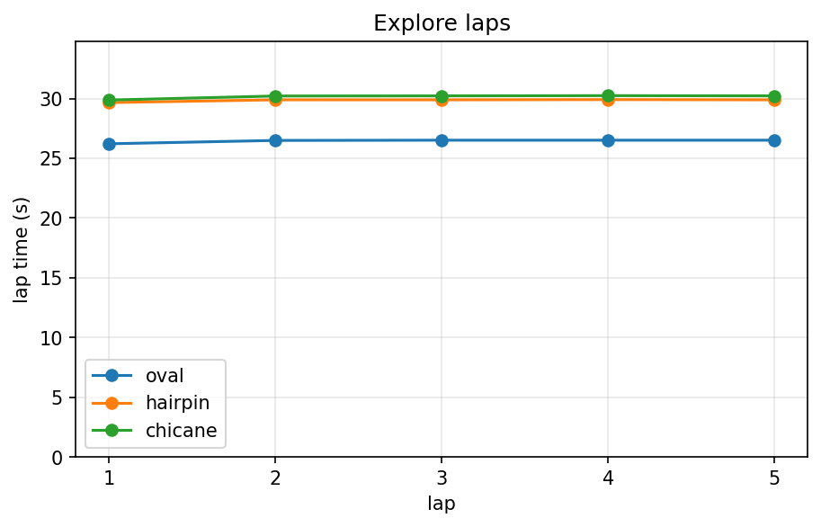

# racecar

A 1/10 scale RC car that learns to race by itself.

Put it on a track it has never seen. It drives one slow lap to map the track, then goes faster every lap after that. If I move the walls around it notices and starts over from the slow lap.

Only sensor is a 2D lidar. All the compute is on the car (Jetson Orin Nano).

Plan:

- write a small 2D simulator first and get everything working there
- then run the same code on the real car

Status: ordering parts. See [shopping-list.md](shopping-list.md).

## Simulator

The simulator is a top-down 2D world built from a PNG (white = road, black = wall). The car gets a fake 2D lidar (108 beams over 270°, 12 m) and nothing else, so the code that drives it can later run on the real car without changes.

```
python -m racer.sim.main                     # drive with the arrow keys, A = autonomous on/off, R = reset
python -m racer.sim.main --track hairpin --headless --laps 5   # no window, as fast as the CPU can go
python tools/make_tracks.py                  # regenerate tracks/oval, hairpin, chicane
python tools/plot_laps.py                    # logs/laps.csv -> docs/plots/explore_laps.png
```

Right now the car can explore: it stays centred between the walls at 0.8 m/s and laps all three test tracks with no crashes. Lap times are flat, which is the baseline the learning part has to beat.


