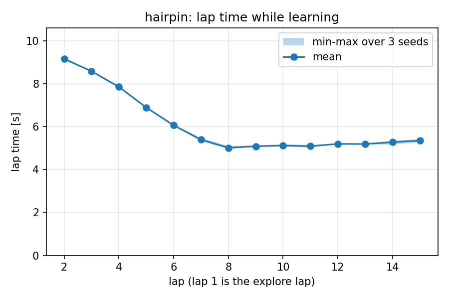
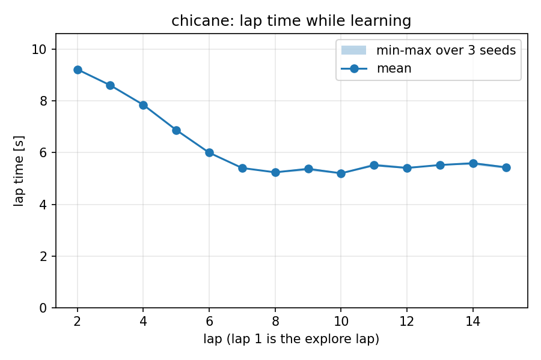
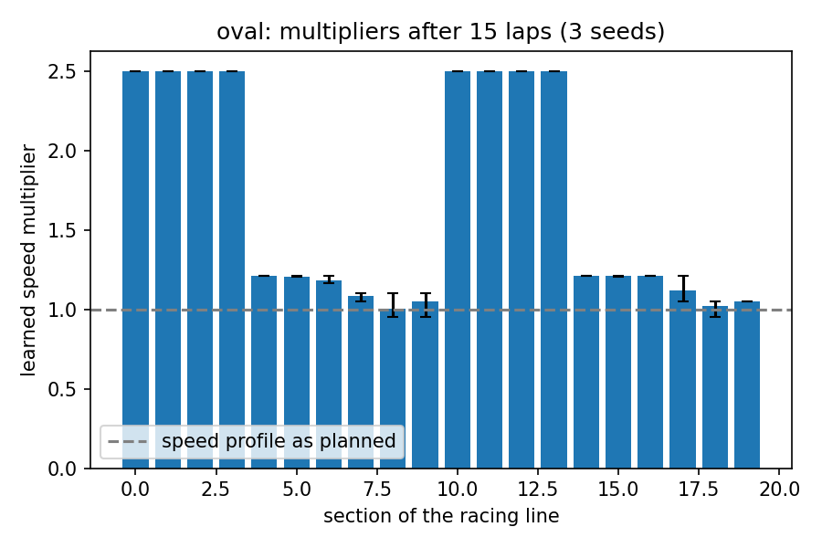
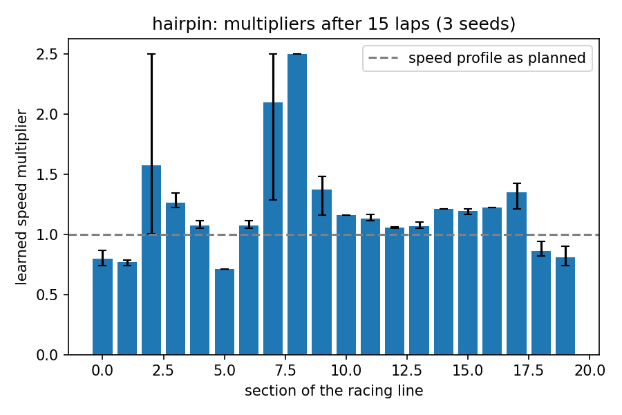
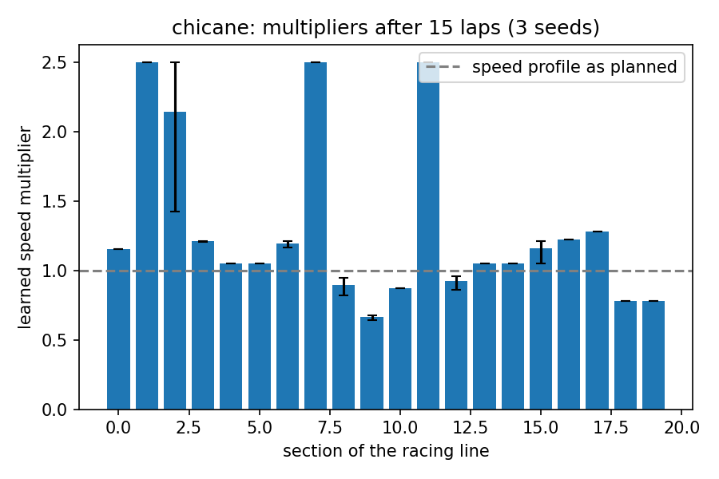
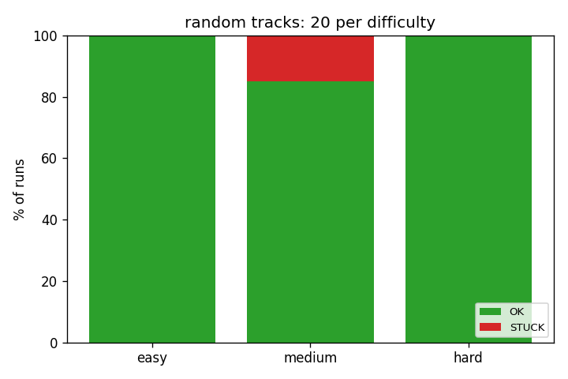

# Simulation results

All numbers come from `logs/laps.csv` and `logs/events.csv` written by `python tools/run_experiments.py`
(three seeds per track, 15 laps each, plus one track-swap run) and summarised by `python tools/plot_learning.py`.
Seeds only change the 1 cm lidar noise. No run crashed.

The sim car has a grip limit (8 m/s², about 0.8 g): a corner taken too fast makes it slide wide, and braking or
accelerating uses up some of that grip. The plan assumes 6 m/s² of cornering grip; the learning finds the rest.

## Learning (15 laps, 3 seeds)

Lap 1 is the explore lap (26 to 29 s on every track). Lap 2 is the first race lap at 60 % of the planned speed
profile. Every section then has a **confidence**: its clean laps in a row. Each clean lap pushes the section up by
5 % times its confidence (5, 10, then 15 % a lap). A problem (the car slid, left the line by more than 0.12 m, or
the safety reflex had to brake) backs the section off 10 %, resets its confidence and remembers the multiplier it
happened at as a ceiling; the section climbs back to just under it and tries 4 % past it after three clean laps.

| track   | first race lap [s] | best lap [s] | laps to within 5 % of best | mean multiplier at lap 15 | lap 15 vs first race lap |
|---------|-------------------:|-------------:|---------------------------:|--------------------------:|-------------------------:|
| oval    | 8.18 | 4.35 | 7 | 1.68 | 46 % faster |
| hairpin | 9.16 | 5.01 | 7 | 1.21 | 42 % faster |
| chicane | 9.23 | 5.20 | 6 | 1.30 | 41 % faster |

Before 2026-10-19 the same tracks ended at 6.17, 6.69 and 6.92 s (a 1.1 multiplier cap, a 3 m/s² plan, and a
reflex that braked for walls the plan never went near). The oval's long sides learn up to 2.5x and are then limited
by the car's 8 m/s top speed; its ends, like the tight parts of the other tracks, settle at the grip limit.

  

  

## Track change (oval to chicane at lap 8)

The chicane PNG replaces the oval under the car while it is racing. Nothing is told to the car.

- last oval race lap 4.42 s, swap, map mismatch jumps from 0.00 to about 0.9
- the car slows to explore speed while the mismatch is above 0.35 and resets 2.0 s after the swap
  (`RACE -> TRACK_CHANGED -> EXPLORE`), deleting map, plan and multipliers
- explore lap on the chicane 28.2 s, first chicane race lap 9.2 s, best chicane lap after 7 race laps 5.3 s

## Obstacles

- **Known boxes** (`--obstacles`, one 0.3 m box per track from `config.yaml`, there before the explore lap): the box
  ends up in the occupancy grid like any wall and the centerline and racing line route around it, keeping at least
  0.35 m from it. All five tracks finish 15 laps with no crash (oval 4.37 s best, hairpin 4.93, chicane 5.20,
  twisty 7.73, snake 8.35). No special code: mapping and planning never knew the difference between a wall and a
  box. (Until 2026-10-19 the oval's box sat inside the outer wall, so the oval run tested nothing, and the hairpin,
  chicane and twisty boxes left gaps of 0.62 to 0.75 m in which the explore lap parked against the box for good.
  Every box now leaves at least 0.9 m and is at least 2.5 m from the start.)
- **Dropped box** (`--drop-box 6.33 0.65 0.3 0.3 --drop-at-lap 3`, a box on the racing line after planning): the
  safety reflex fires once (`min_ttc` 0.31 s) and slows the car; the new wall cells are mapped while racing, which
  triggers a replan around the box. Laps 7.07, 6.63, 5.90, 5.33, 5.05, then 4.92 s at best. Zero crashes over 15
  laps. A longer box right on the line (`--drop-box 6.0 1.3 0.6 0.3`) makes the car visibly swerve and settles at
  5.7 s.
- The track-change detector reported a mismatch of 0.05 to 0.13 while the box was in view, far below the 0.35
  threshold: one box is an obstacle to route around, not a new track.

## Safety events

19 reflex episodes over all 10 runs, none in the first race lap. While the car is on its plan the reflex checks the
path pure pursuit will really drive (the controller run forward on the bicycle model, corner cutting included)
against the live scan, and only brakes for something on that path; off the plan it falls back to the arc check.
Each episode marks its section as a problem, so the multiplier backs off.

## Bolder racing (2026-10-19)

On a random hard track the old car's best lap was 12.09 s and it got slower again (14.4 s by lap 20): four sections
sat at the 0.2 multiplier floor. The reflex fired there every lap even at low speed, because it judged the arc the
current steering would drive for 0.6 s and that arc ran into walls the plan never went near; every firing cost the
section 15 %, every clean lap gave back 8 %. What changed, each found by tracing a failure:

| change | why |
|---|---|
| grip limit in the sim (8 m/s², brakes and throttle take theirs first) | without it the only limits were guesses |
| plan assumes 6 m/s² cornering, 5 braking, 4 accelerating (was 3, 4, 2.5) | real numbers for a 1/10 brushless car |
| confidence-sized steps, ceilings, no 1.1 cap | the old fixed steps saw-toothed and never got near the limit |
| a crash grades the partial lap at once | the lap restarted after every crash, so the section was never slowed and the car crashed there forever |
| target speed = profile x multiplier, then braked again | a slowed section was entered at its neighbour's speed |
| slip detector: yaw rate from the pose vs `v tan(steer) / L` | slides were invisible until they hit a wall; same check works with the car's IMU |
| lift off while sliding | a driver would |
| reflex trusts the plan, checks the path pure pursuit will drive | removes the false alarms, catches corner cutting into a box |
| racing line keeps 0.35 m from every mapped wall or box | 0.3 from the centerline width was 0.25 in practice, less than half the car plus tracking error |
| speed profile reads curvature over 0.6 m | a few-cm kink next to a box read as a 0.2 m hairpin |

Same track afterwards: first race lap 12.5 s, best 7.57 s, steady at 7.8 s, no crash. With the plan driven
perfectly at the full grip the lap would be about 7.0 s, so most of what is left is the margin kept around the
boxes. On the 90-track benchmark the best lap got 34 to 36 % faster (easy 5.82 -> 3.82 s, medium 6.40 -> 4.08 s,
hard 8.05 -> 5.24 s), still with no crash.

## Reverse recovery

The car can now reverse (at most 0.5 m/s). When it wants to drive but has not moved for 1 s, it backs up 0.5 m
(0.75 m, 1.0 m on later tries at the same spot) with the wheels turned away from the side the controller is aiming
for, so the nose swings toward the way out. The back-up stops early if the body would touch a wall already in the
map or the outermost beams see something within 0.2 m. After three tries at one spot, or 30 s without getting 1 m
anywhere, it gives up: headless runs end with `STUCK` and exit code 3 instead of running until `--max-s`.

The old, too-tight config boxes make good test cases, dropped at lap 0 (`--drop-box X Y 0.3 0.3 --drop-at-lap 0`):

| box | gap | before | with recovery |
|---|---|---|---|
| chicane (4.0, 1.3) | 0.64 m | parked for good at 26 s of the explore lap | one back-up in the explore lap, then 6 laps down to 7.85 s, no crash |
| twisty (6.0, 0.55) | 0.75 m | parked for good | one back-up, then 6 laps down to 9.95 s, no crash |
| hairpin (5.0, 1.25) | 0.62 m | parked for good | `STUCK` after three tries at the same spot in the second lap, at 69 s |

Recovery gets the car out; it does not make a gap the planner cannot use drivable. That is the generator's job: it
never puts a box closer than 0.85 m to the far wall.

## Random tracks

`python tools/bench_random.py --n 30` generates 30 tracks per difficulty (10 x 7 m area, known, dropped and slalom
boxes) and drives each for 10 laps headless, in parallel, each run in its own log folder.

| difficulty | runs OK | lap | explore lap | first race lap (mean) | best lap (mean) | best vs first | back-ups |
|---|---|---|---|---|---|---|---|
| easy   | 30 / 30 | 12.5 - 16.3 m | 16 - 25 s | 7.3 s | 3.8 s | 47 % faster | 5 |
| medium | 30 / 30 | 12.2 - 17.8 m | 19 - 30 s | 7.5 s | 4.1 s | 45 % faster | 7 |
| hard   | 30 / 30 | 16.8 - 26.0 m | 28 - 49 s | 9.7 s | 5.2 s | 46 % faster | 5 |

No crash, no false track change, and the best lap beats the first race lap on all 90. On 300 tracks of the large
size (10 x 10 m, seeds 100 to 199): 300 of 300 OK, no crash. The same 300 with recovery switched off
(`recovery.max_attempts: 0`): easy 95, medium 75, hard 73 OK; the other 57 park against a box or a wall.

 

What the generator found out on the way:

- A corner drawn as 12 points reads as a much tighter corner than it is once resampled, so generated arcs get a
  point every 2 cm.
- Star-shaped polygons with corners pulled far in make narrow V-shapes; the grid-cell outline cannot, because a blob
  with no holes and no corner-only contacts never comes within one cell of itself.
- A box makes the planner's racing line kink sideways over a few centimetres. Pure pursuit never follows that
  literally (it aims at least 0.5 m ahead), so the line is judged on points 0.5 m apart.
- Asking for every kind of box on every track pushed the hard tracks toward plain rectangles (only they had room);
  boxes are now placed where they fit, and a slalom only appears where there is a long enough straight
  (most easy tracks, a few medium and hard ones).
